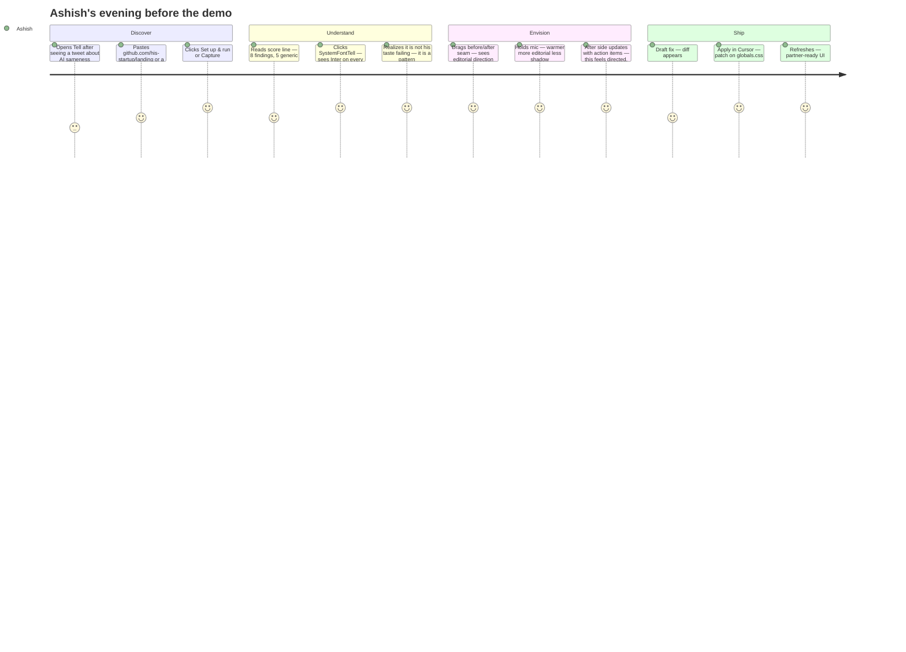

# User Story — Tell

> Viewers should feel Ashish's problem before they see the pipeline. Lead demos with his journey.

> **Redesign plan (proposed, pending decision):** DesignProof is moving to a concept-first, step-by-step design process: eight reviewed stages (brief, concepts, mood board, art direction, imagery, one key screen, section by section, refinement), colour from a theme setting, an automatic swap test, and Awwwards-weighted review with Open Design as the bar. Plan: [DesignProof redesign plan](https://linear.app/bimlabz/document/designproof-redesign-plan-concept-first-step-by-step-design-7f1f65ec2bc3) · Decision: [BIM-203](https://linear.app/bimlabz/issue/BIM-203/decide-designproof-redesign-plan-concept-first-step-by-step-and-the). Template keep, merge or drop calls are **proposals** until Ashish decides in BIM-203; nothing has been dropped.
>
> Motion gets its own review between art direction and refinement; it is not a separate stage.

---

## Persona: Ashish

| | |
|---|---|
| **Who** | Solo founder, technical, ships with Cursor daily |
| **Built** | B2B SaaS MVP in one weekend using Cursor Agent |
| **Problem** | Landing page works but looks like every other AI-built product |
| **Stakes** | Investor demo tomorrow; embarrassed to share the URL |
| **Constraint** | No designer, no time for a full rebrand, can't afford to break what works |
| **Goal** | Distinctive, trustworthy UI he can art-direct himself — inside Cursor |

---

## Before Tell (the pain)

Ashish's internal monologue:

> "I shipped this in a weekend. Why does it look exactly like the last three products I bookmarked on Product Hunt? Inter font, purple gradient, shadow on every card, emoji in the nav. I *know* something is wrong but I can't name it. ChatGPT says 'add more whitespace.' That's not a direction."

**What he tries today (and why it fails):**

| Approach | Why it fails |
|---|---|
| Ask Cursor Agent to "make it prettier" | Agent picks the same defaults — another violet gradient |
| Figma token diff tools | He never had Figma tokens; he vibe-coded in Cursor |
| Hire a designer for a day | $800 and 2-week queue; demo is tomorrow |
| Copy a Dribbble shot | Looks pasted-on; breaks his component structure |

---

## User journey (the product flow)

---

## Scene-by-scene (demo copy)

### Scene 1 — Empty state
**Ashish sees:** `No capture yet.` / `Paste your app URL — Tell reads what users actually see.`
**Feels:** Low friction; not another dev tool dashboard.

### Scene 2 — Capture
**Ashish sees:** Progress readout `Launching headless browser…` then `Capture complete.` — or, for a GitHub repo, a setup panel: Cloning → Installing → Waiting for reachable URL → Running → auto-capture. The old preview is hidden while setup/capture is in progress, and failures say what URL could not be reached.
**Feels:** Tell is looking at the *real* product, not his repo structure. He knows when the app is working, when it failed, and what to do next.

### Scene 2b — Multi-page (optional beat)
**Ashish sees:** Pages strip with `/`, `/pricing`, `/about` discovered from his snapshot. He scans `/pricing` and finds a drift finding that only shows there.
**Feels:** Tell catches inconsistency across the surface, not just the hero.

### Scene 3 — The tell (emotional beat)
**Ashish sees:** `SystemFontTell · GENERIC` — *"Inter appears on every text role with no display face. This is the default AI type stack, not a considered choice."*
**Feels:** Named the shame. Evidence on screenshot with proof-mark pin.

### Scene 4 — Taste (credibility beat)
**Ashish sees:** A brutalist section marked `INTENTIONAL` — *"Single-family mono is a documented choice on this route."*
**Feels:** Tell has taste, not lint rules.

### Scene 5 — Before/after (the aha)
**Ashish drags the seam.** Left: his captured page as it actually renders. Right: the same page with reconciled tokens — type hierarchy, accent, radius, depth, focus ring, and contrast floor — grounded in what Tell measured.
**Feels:** "This is a direction I can defend" — not a random reskin.

### Scene 6 — Voice art-direction
**Ashish says:** "Warmer, more editorial, less shadow."
**Ashish sees:** Tell breaks that into action items and maps it to a direction preset before any model refinement.
**Feels:** Art-directing like a creative director, not writing CSS.

### Scene 7 — Reconcile in Cursor
**Ashish clicks:** `Apply in Cursor` → patch copied → Agent applies → refresh.
**Feels:** Closed loop. Still in his workflow. No export, no handoff.

---
### Scene 8 — Design a new site, step by step (proposed, see the redesign plan)
**Ashish starts from a brief, not a template.** DesignProof doesn't produce a whole site in one pass. It works in reviewed stages, and he approves or rejects each one before the next starts:
1. **Brief:** real facts, audience, goal, and the one thing only this business has.
2. **Concept:** two or three one-line ideas, each with a metaphor or material, what it rejects, and three tests that show it on the page. He picks one.
3. **Mood board:** credited references from the concept's world, not from competitors.
4. **Art direction:** type, colour theme (a named theme setting, never derived from the product name), spacing, a signature device, and a one-line motion idea.
5. **Imagery:** real or generated photos, artefacts or 3D that carry the concept, in modern formats (WebP, AVIF, WebM).
6. **Key screen:** one hero screen on desktop and mobile, kept or thrown away.
7. **Section by section:** each section rendered and reviewed on its own.
8. Refine and polish: a removal pass, performance, and an Awwwards-weighted review. Motion is checked separately before this stage, using the review tool, and builds on the motion idea set during art direction.

An automatic **swap test** runs at every stage: the same stage is rendered with an unrelated brand, and if the idea and copy don't change, it fails.
**Feels:** "This was designed for us," not "this is a template with our name on it."

## Success metrics (user-centric)

| Metric | Target |
|---|---|
| Time to first finding | < 10s on fixture |
| "Named my problem" moment | SystemFontTell or GradientCrutchTell with evidence |
| "Saw a future" moment | Seam drag before/after |
| "This is grounded" moment | Contrast floor and token changes visible in reconciliation table |
| "Shipped the fix" moment | Diff applied in Cursor without leaving IDE |
| Emotional outcome | Ashish would share Tell in Cursor Discord |
| "Designed for us" moment | Concept approved at stage 2; swap test passes on key screen |
| Quality bar | Awwwards-weighted self-review at or above Open Design level on the final stage (bar defined in the redesign plan) |

---

## What Tell is NOT (for viewers)

- Not a codebase mind-map (crowded space)
- Not a Figma token differ (saturated space)
- Not a dashboard of KPIs (disqualifying pattern)
- Not auto-apply without human review

- Not one-pass "generate the whole site" — every stage is reviewed before the next (proposed, pending BIM-203)

---

## Copy bank (use in UI)

| Context | Copy |
|---|---|
| Hero | Every AI-built UI has a tell. |
| Subhead | Capture your product, name what's generic, art-direct a direction, apply the fix in Cursor. |
| Empty CTA | Capture my app |
| Finding rationale tone | Direct, specific, no apology — senior designer note |
| Voice placeholder | Describe the direction — warmer, editorial, less shadow… |
| Dogfood line | Tell runs on itself: zero tells. |
| Ashish quote (landing) | "I couldn't name what was wrong. Tell showed me in thirty seconds." |

---

## Secondary persona (stretch)

**Marcus** — design engineer at a startup. Uses Tell in Cursor MCP during PR review: *"tell_diagnose this preview URL before merge."* Same engine, different entry point. MCP is the power-user path; the web UI is the emotional demo path.
